# AI Powered Translations

## Backoffice Functionality

### Translation Action

In the list view of the Localized Values an action is available to execute automated translations powered by AI.

The action would open a popup window allowing to configure the following:

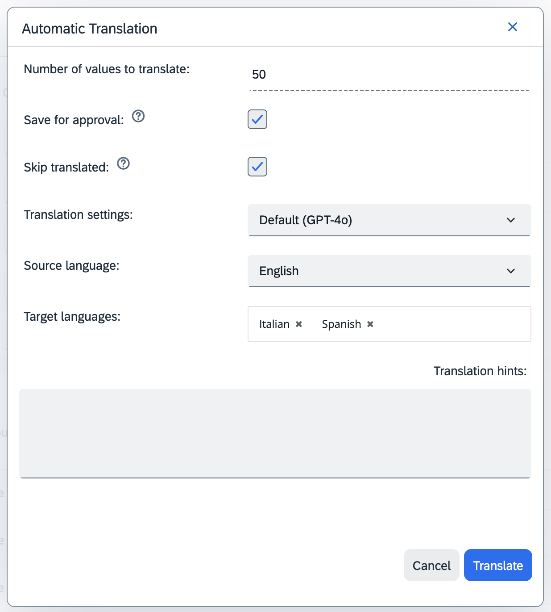.

* **Save for approval** - Choose if the result of the translation should be stored in intermediate items - **CxProposedTranslation**s for later approval. In such case the translation won't be stored at the target item until it's approved. E.g. the name for a product will be stored in a Proposed item instead of storing it directly at the product level. If set to false the value would be stored directly at the target item level.
* **Skip translated** - Choose if the translation should be skipped for values that are already present in the target language.
    * The property `cxtranslations.proposedtranslation.autoremove.missing.targetlanguages` determines if a proposed translation should be removed in such case.
* **Translation settings** - the AI translation settings
* **Source language** - the language used as source for the translation.
* **Target languages** - list of languages to which the values would be translated.
* **Translation hints** - optional hints that might provide context for the AI translation - e.g. the values represent the names of powertools products.

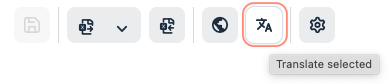

#### Adding the AI translation action to other items

A similar action has been added to following Item types:
* **CxLocalizedLabel**
* **Product**
* **Category**
* **CMS Item**
* **Unit**
* **Classification Attribute (Feature Descriptor)**
* **Classification Attribute Value (Feature Value)**
* **Classification Attribute Unit (Unit of Measurement)**

The action `com.sap.cx.translations.backoffice.widgets.actions.aitranslate.external` can be added `listviewactions` for every item in the system by the following configuration.
See example below for a **Product** item type.

```xml
<context type="Product" merge-by="type">
	<context component="listviewactions" merge-by="type">
		<y:actions>
			<y:group qualifier="translate" show-group-header="false" show-separator="true" position="55">
				<y:action action-id="com.sap.cx.translations.backoffice.widgets.actions.aitranslate.external"
						  property="pageable.typeCode"
						  position="80">
					<y:parameter>
						<y:name>max.rows</y:name>
						<y:value>1000</y:value>
					</y:parameter>
					<y:parameter>
						<y:name>safety.threshold</y:name>
						<y:value>500</y:value>
					</y:parameter>
				</y:action>
			</y:group>
		</y:actions>
	</context>
</context>
```


The action would open a popup window, similar to the one for localized values, allowing to configure additionally the list of attributes to be translated:

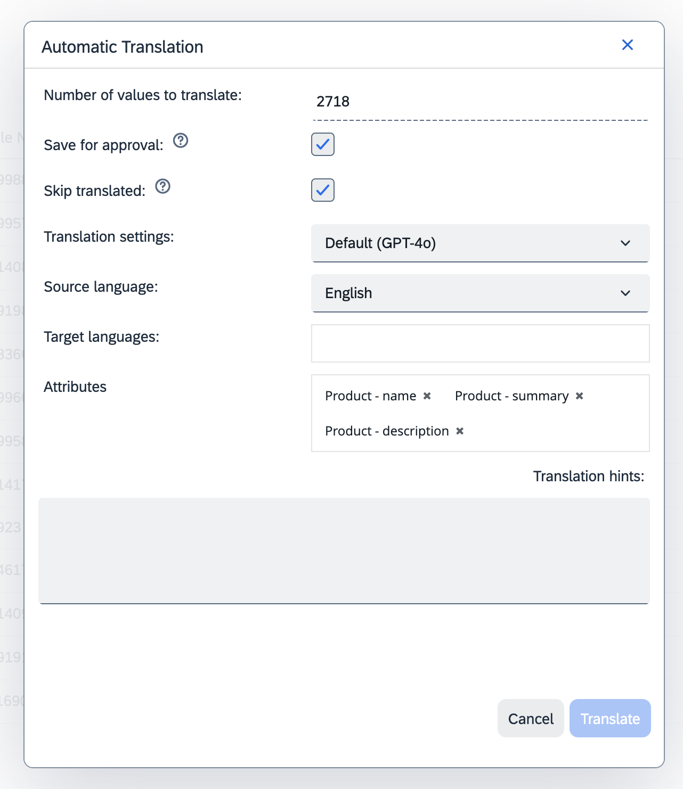.

* **Attributes** - list of attributes to be translated for the given items.


#### Proposed translation configuration
As a result of running the translation **CxProposedTranslation** items are created. They also indicate if the translation has been executed or not. By default, this behaviour is disabled. This is configured by two properties:
* The property `cxtranslations.proposedtranslation.autoremove.missing.targetlanguages` determines if a proposed translation should be removed in case the option to skip translated values has been selected and there was indeed nothing to translate.
* The property `cxtranslations.proposedtranslation.autoremove.missing.sourcevalue` determines if a proposed translation should be removed in case the value for the source language was missing therefore there was nothing to translate.

Executing the translation would result in running an asynchronous **CxTranslationCronJob** in the background. 


To check the progress see the processes in top right corner.

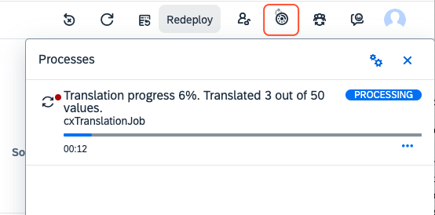

The progress can be also checked in HAC under the cron jobs tab

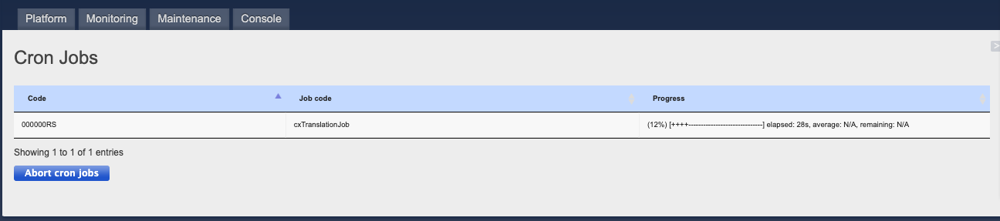

To check the final result of the translation, in case of selecting the option **Save for approval**, check the Proposed Translations.

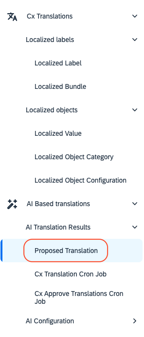

### Limit for Number of Translated Values

With default implementation it is not possible to select more than 5000 Localized Values to be translated automatically at once.
This setting can be found in: `cxtranslationsbackoffice-backoffice-config.xml`

```xml
<context type="CxLocalizedValue" parent="CxAbstractLocalizedValue" merge-by="type">

    <context component="listviewactions" merge-by="type">
      <y:actions>
        <y:group qualifier="translate" show-group-header="false" show-separator="true" position="50">
          <y:action action-id="com.sap.cx.translations.backoffice.widgets.actions.aitranslate"
                property="pageable.typeCode"
                position="80">
            <y:parameter>
              <y:name>max.rows</y:name>
              <y:value>5000</y:value>
            </y:parameter>
            <y:parameter>
              <y:name>safety.threshold</y:name>
              <y:value>3000</y:value>
            </y:parameter>
          </y:action>
        </y:group>
      </y:actions>
    </context>

</context>

```

Change `max.rows` attribute to change this limit. 

Change `safety.threshold` attribute to remove warning if number of values to translate is above 3000. 
### Proposed Translation

Results of performing AI translations depend on the **Save for approval** flag, when it is set to:
* **true** - for each object that was send to translation **Proposed Translations** is created awaiting for manual review and confirmation.
* **false** - results are directly saved on the target items.

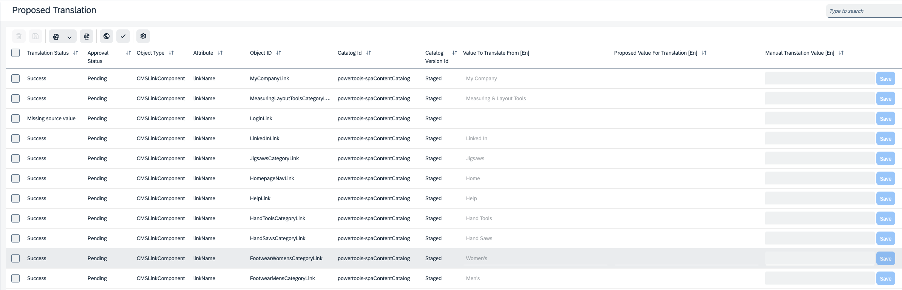

Depending on the translation result the **CxProposedTranslation** can have one of three states:
* `PENDING` - translation still in progress
* `SUCCESS` - translation finished successfully
* `MANUAL` - translation provided manually
* `ERROR` - translation finished unsuccessfully
* `MISSING_SOURCE_VALUE` - nothing to translate. The value for the source language was missing.

In case the AI translation provided any feedback or issues occurred during the process the NOTES field for a **CxProposedTranslation** will be filled in.

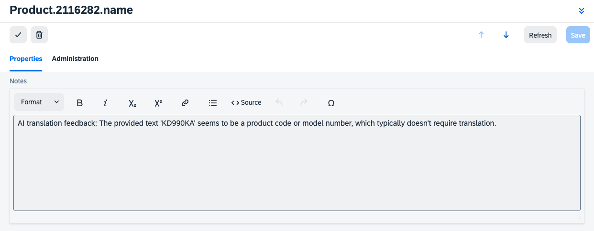

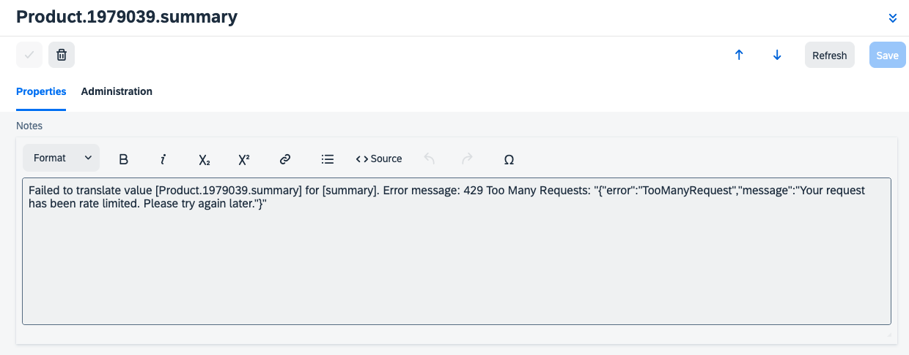

### Providing Translations Manually
In case the translation provided by AI was unsuccessful or is invalid user can provide the translation manually by editing the **CxProposedTranslation** either in the list view or in editor view.

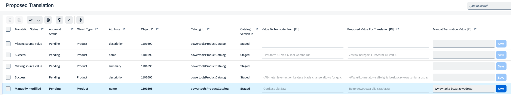

In editor view navigate to the VALUES section. The following values are visible:
* Read only **Localized Value** - the value currently stored at target item. E.g. the product name
* Read only **Proposed translation value** - the proposed value provided the AI translation. E.g. the product name not yet stored product name, provided by AI
* Read & write **Translation value provided manually** - the translation value that can be provided manually by the end user to overwrite the value provided by AI translation.

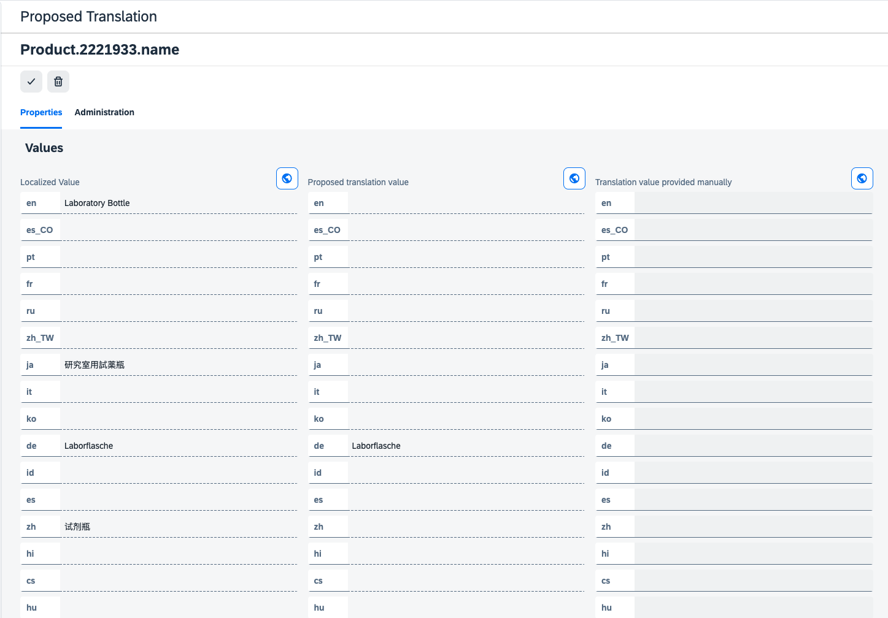

> [!WARNING]
> 
> Running the approval action for **CxProposedTranslation** save the changes on the target items automatically.

### Approving Translations

To save the automatically provided translation at the target item the translation needs to be approved. This can be done by a translation approval action.
The Approval would only run for the translations with statuses:
* `SUCCESS` - translation finished successfully
* `MANUAL` - translation provided manually

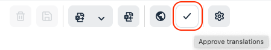

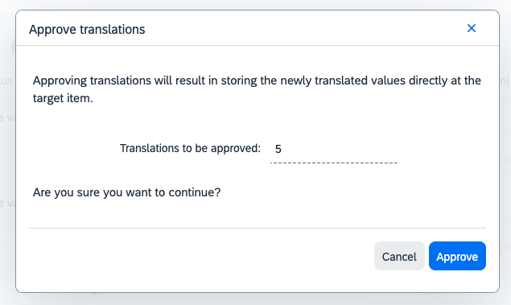

Executing the action runs an asynchronous **CxApproveTranslationsCronJob**.


The progress of the execution can be monitored in backoffice under processes or in hac in cron jobs tab.  

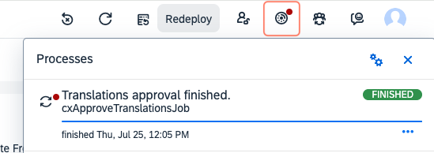

In case the Approval was successful the **CxProposedTranslation** would be removed as no longer needed, the value would be stored at target item.
In case the approval was not successful it won't be removed. It will be marked with a proper status. 

Depending on the translation approval result the **CxProposedTranslation** can have one of three states:
* `PENDING` - approval not yet executed
* `SUCCESS` - approval finished successfully
* `ERROR` - approval finished unsuccessfully

### Rejecting Translations

To reject a translation select the translations to be rejected and run the rejection action. 
It will delete the proposed translation items for the selected translations.

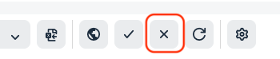

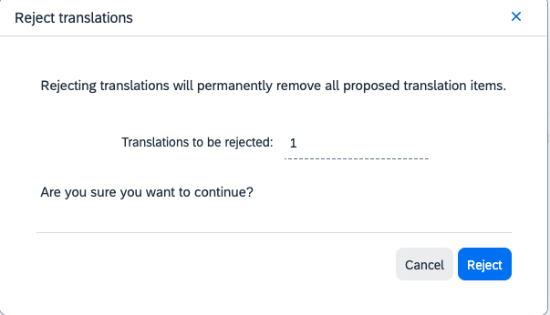


### Retrying Translations

Selected Proposed Translation items can be retranslated by running the Retry action. 
Some of the translation settings can be adjusted for the new translation attempt which facilitates testing different settings for the translation without leaving the proposed translations list view.

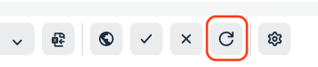

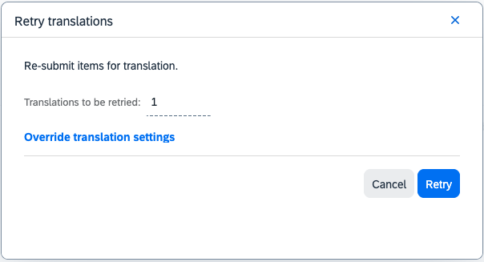

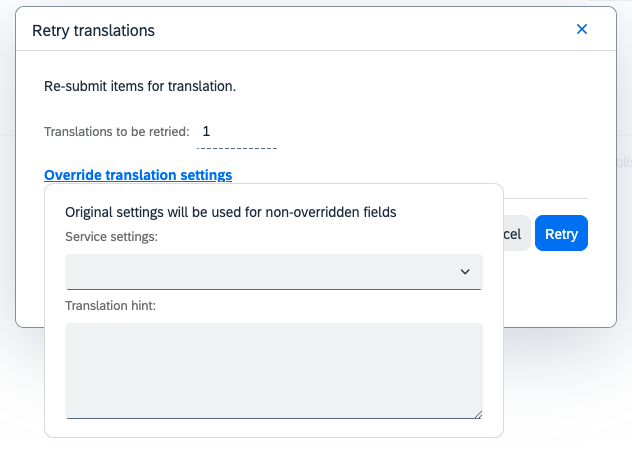