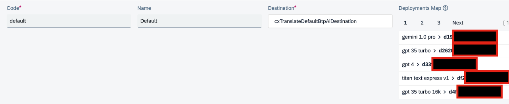
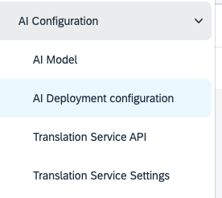
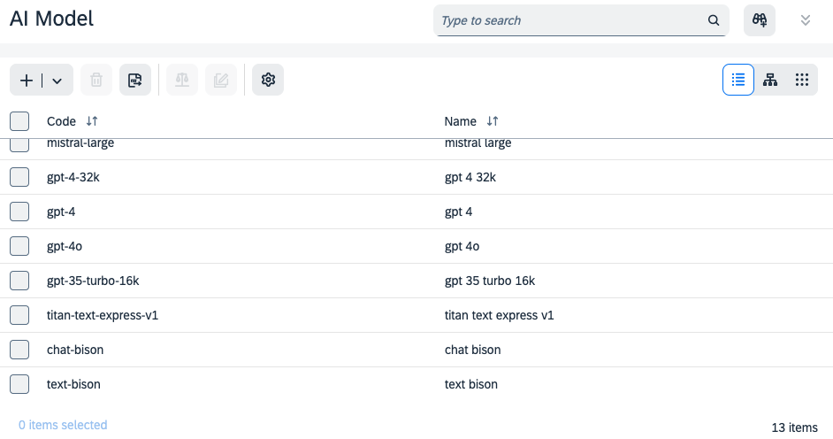

# AI & Translation Provider Configuration

> [!NOTE] Configuration has been split into provider-specific guides. Choose your provider:
>
> - [SAP AI Core on BTP](installation/provider-sap-ai-core.md) — LLM translations via SAP AI Core (GPT, Claude, Gemini, …). Default provider.
> - [SAP Translation Hub](installation/provider-sap-translation-hub.md)
> - [DeepL](installation/provider-deepl.md)
> - [Azure Translator](installation/provider-azure.md)

---

## AI Translation Service API Reference

This section documents the `CxAiTranslationServiceApi` item type in detail. It is relevant when customising the LLM request template or adding support for a new AI endpoint.

### Endpoint URL

By default, CX Translate uses `cxTranslateDefaultBtpAiDestination` as the source of connection settings for AI Integration. The `URL` field is used as a base when constructing URLs for specific endpoints (example: `https://api.ai.prod.eu-central-1.aws.ml.hana.ondemand.com`). Adjust it if necessary.

### Credentials

By default `cxTranslateDefaultBtpAiDestination` uses `cxTranslateDefaultBtpAiCredentials` to define the OAuth credentials. Fill in:

- **Client ID**
- **Client Secret**
- **OAuth URL** (example: `https://sapit-core-playground.authentication.eu10.hana.ondemand.com/oauth/token`)

### AI Deployment Configuration

Deployment IDs are used to construct the URL to endpoints serving specific AI models. They are obtained when getting access to SAP AI Core and configured in `CxAiDeploymentConfig`:

- Consumed destination (default: `cxTranslateDefaultBtpAiDestination`)
- AI Model → Deployment ID mapping

The `default` configuration is used out of the box. Normally only the **Deployment Map** needs to be adjusted.

### Advanced Configuration

### AI Models

AI Model items contain a simple enumeration of known models. No logic is defined at this level.

> [!WARNING]
> - The list contains models available in SAP AI Core at implementation time.
> - Only some of them have `AI Translation Service API` configured out-of-the-box.
> - New models can be added as `CxTranslateAiModel` items as they become available.

### Translation Service API Fields

`CxAiTranslationServiceApi` defines how the external translation service is called. The `sapBtpAiOpenAiGpt5` configuration (for GPT-5 family) is used as an example:

| Field | Description | Example value |
|---|---|---|
| Endpoint URL | URL suffix appended to the destination base URL. Supports `{deployment}` and `{model}` placeholders. | `/v2/inference/deployments/{deployment}/chat/completions?api-version=2024-10-21` |
| Deployment Configuration | Reference to `CxAiDeploymentConfig` | `Default` |
| Configurable parameters | Parameter names that can be overridden per-request | `temperature,frequency_penalty,...` |
| Default parameter values | Default values for those parameters | `temperature->0.1\|frequency_penalty->0.3,...` |
| Logging Level | When to persist the full response: `NEVER`, `ERROR_ONLY`, `ALWAYS`. Use `ALWAYS` only for development. | `NEVER` |
| Request template | Groovy Simple Template Engine template. Placeholders: `${parameters.XXX}`, `${model}`, `${requestJson}`, `${responseSchemaJson}`. | See `sapBtpAiOpenAiGpt5` in Backoffice |
| JSON Path | JSON Path to extract the translation from the response | `$.choices[0].message.content` |
| Usage Metrics Paths | Map of metric names to JSON Paths for cost tracking | `inputTokens->$.usage.prompt_tokens\|outputTokens->$.usage.completion_tokens` |
| Custom Request Writer Spring Bean | Spring bean ID for custom request serialisation (advanced) | *(empty)* |
| Custom Response Reader Spring Bean | Spring bean ID for custom response deserialisation (advanced) | *(empty)* |

### Translation Service Settings Fields

`CxTranslationServiceSettings` aggregates everything the user selects when triggering a translation.

| Field | Description | Example value |
|---|---|---|
| Is default | If `true`, selected by default in the translation popup | `false` |
| Translation Service API | Chosen `CxAiTranslationServiceApi` | `sapBtpAiOpenAiGpt5` |
| AI Model | Model to use; must be supported by the selected API | `gpt-5-mini` |
| Global Translation Hints | Hints added to every request | *(e.g. "These are powertools product names")* |
| Max languages in a request | Max target languages per request; smaller values improve quality | `2` |
| Cost per unit | Cost per usage metric unit | `inputTokens->0.00001\|outputTokens->0.00002` |
| Registered usage | Accumulated usage metric values; updated after each request | `inputTokens->1000\|outputTokens->2000` |
| Total Cost | Read-only; calculated from cost per unit × registered usage | `0.003` |
