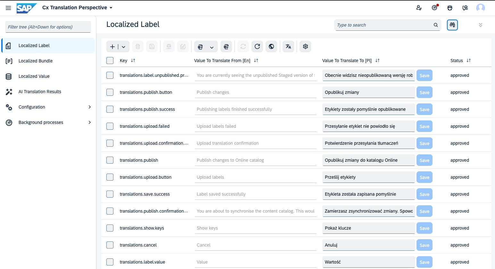

# Backoffice Perspective

## Cx Translation Perspective

A new **Cx Translation Perspective** has been created to gather all items & actions offered by CX Translation related to translations.
It can be accessed in backoffice in the standard way.

## User Groups

By default, admin users have access to the new perspective. However, in real-world scenarios, users responsible for translations should not be granted admin access to the backoffice. To address this, new user groups have been defined. \
Users assigned exclusively to these groups will have access to the new perspective and its functionalities without the risk of compromising the system or corrupting data.

* `cxTranslationsBasicGroup`- the parent group for all other translation related groups. Access to catalogs and generic access rights for types & attributes is configured on this group level. Not a backoffice role, no users should be added to this group directly.
* `cxTranslationsConfiguratorGroup` - responsible for configuring the `CxLocalizedObjectConfig`s, can execute the `CxLocalizedObjectConfigCronJob` executing the `Localized Object` configuration. See the [Localized Object & Configuration](/localizedValues.md).
* `cxTranslationsTranslatorGroup` - responsible for translating manually (for [`Localized Labels`](/localizedLabels.md) and [`Localized Values`](/localizedValues.md)), executing and approving the result of an [AI translation](/aitranslations.md).
* `cxTranslationsAiConfiguratorGroup` - responsible for configuring the AI settings - see more [AI Configuration section](/aitranslations_configuration.md)
* `cxTranslationsAdminGroup` - user group having full access to the translation perspective, sharing the responsibility of all the previously mentioned groups.

## Users

A single user has been created for every translation group:

* `cxtranslationsconfigurator` in `cxTranslationsConfiguratorGroup`
* `cxtranslationstranslator` in `cxTranslationsTranslatorGroup`
* `cxtranslationsaiconfigurator` in `cxTranslationsAiConfiguratorGroup`
* `cxtranslationsadmin` in `cxTranslationsAdminGroup`

> [!WARNING] **Inactive users by default.**
> 
> For security reasons users are not set as active by default.
> 
> To activate these users and/or set passwords modify `core-customize/hybris/bin/custom/cx-translations/cxtranslations/resources/cxtranslations/impex/usergroups.impex` or set them as active in backoffice.