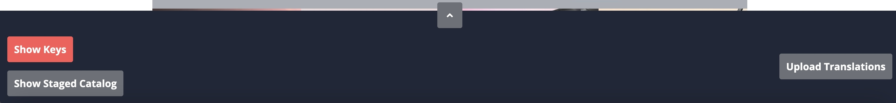

# Frontend Admin Component

The `CxTranslationsAdminComponent` is an optional CMS flex component for the SAP Composable Storefront. It provides in-browser label management — view, edit, and publish `CxLocalizedLabel` values — without opening Backoffice.

For a full description of the component's features and usage, see [Managing Localized Labels in the Storefront](localisedLabels/localizedLabels_storefront.md).




---

## Prerequisites

- Commerce extensions installed and running — see [Commerce Extensions Installation](commerce-extensions.md)
- Storefront module installed — see [Storefront Module Installation](storefront-module.md)
- System setup ImpEx imported — see [System Setup](system-setup.md)

---

## Step 1 — Import the CMS Component ImpEx

Import `admin-component.impex` to create the component and its CMS restrictions.

**[Download admin-component.impex](/downloads/admin-component.impex ':ignore')**

The file:
- Creates the `CxTranslationsAdminComponent` CMS flex component in the `SiteLogoSlot`
- Creates `frontendTranslatorGroup` user group with read/write access to `CxLocalizedLabel` and `CxLocalizedBundle`
- Creates two `CMSUserGroupRestriction` items so the component is only visible to:
  - Members of `frontendTranslatorGroup` (regular storefront users)
  - Members of `cmstranslatorgroup` (ASM agents)

**Required adjustments:**

| Macro | Description | Example |
|---|---|---|
| `$contentCatalog` | ID of your content catalog | `electronicsContentCatalog` |

The macro `$contentCV` is derived automatically. In a **multicountry setup**, use the **global content catalog** (the catalog without any parents).

---

## Step 2 — Import UI Labels

Import `admin-component-labels.impex` to populate the UI strings used by the component.

**[Download admin-component-labels.impex](/downloads/admin-component-labels.impex ':ignore')**

The file creates the `CxLocalizedBundle` named `translations` and inserts all UI label keys with English (`en`) and Polish (`pl`) values.

**Required adjustments:**

| Macro | Description |
|---|---|
| `$contentCatalog` | ID of your content catalog |

> [!NOTE] Add `value[lang=XX]` columns for any additional project languages.

---

## Step 3 — Enable the Upload Button in the Storefront

The **Upload labels** button in the component is controlled by a frontend environment flag. Enable it only on environments where label import from static files is needed, and disable it in production.

```ts
// environment.prod.ts
translationUploadButton: false

// environment.ts (dev / staging)
translationUploadButton: true
```

> [!WARNING] Leaving `translationUploadButton: true` in production allows any component-visible user to overwrite existing labels by re-uploading the static translation files.

---

## Step 4 — Execute Content Catalog Synchronisation

After importing both ImpEx files, run a **content catalog synchronisation** to publish the new CMS component from the Staged to the Online catalog version.

---

## Step 5 — Grant Access to Users

The component is rendered only for users in `frontendTranslatorGroup` or `cmstranslatorgroup`. Assign users as needed:

- To let a **customer** manage labels: add the customer account to `frontendTranslatorGroup`.
- To let an **ASM agent** manage labels while emulating a customer: add the ASM user to `frontendTranslatorGroup`.

---
