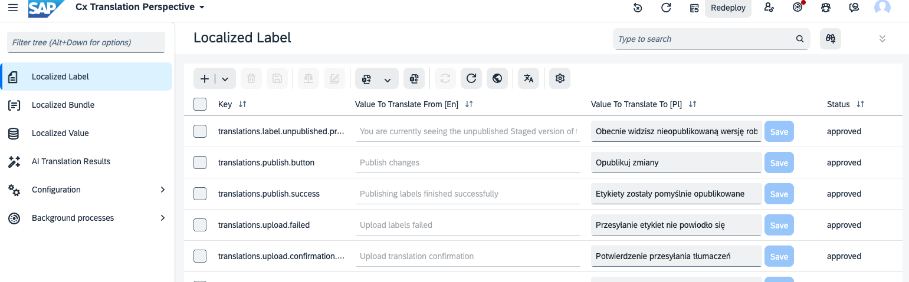
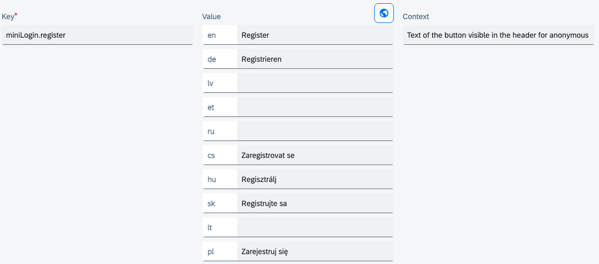
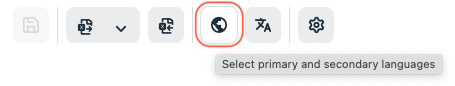
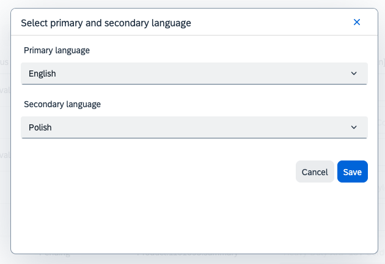
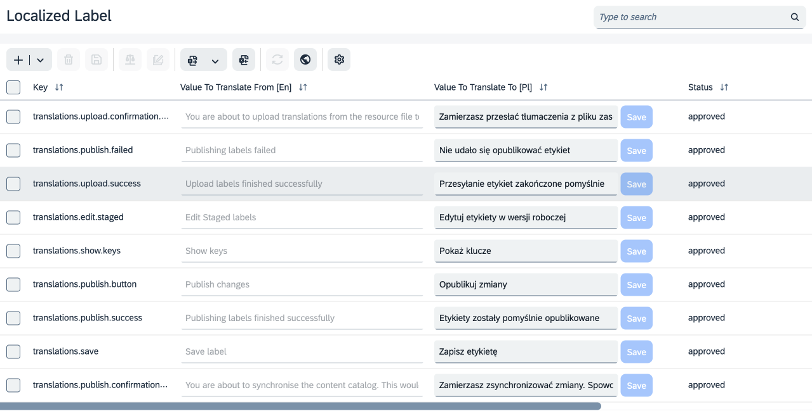
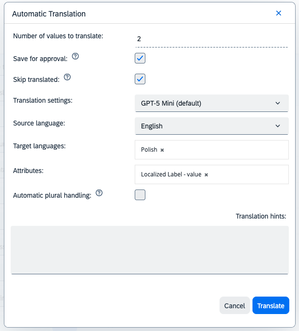
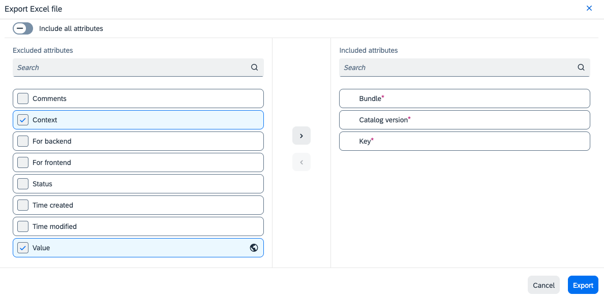

# Managing Label Values in Backoffice

**Backoffice view:** 

Each label can be modified individually. The value can be edited for any language defined in the system (even for those not visible on the storefront). For each label, some context can be provided (just for helping translators) and each label belongs to some bundle (or chunk if you will). This is purely an organizational thing (used by SAP Composable Storefront to lazy-load translations) and should not be changed. Once the value is changed it can be synchronized to the Online catalog (by clicking the `sync` button).
The changes can be introduced in the ListView or in EditorView.

### Primary & Secondary Language Action

The primary & secondary language action allows you to preview & edit in list view a localized labels in two different languages:
* Read only **primary language** value (to translate from)
* Read & write **secondary language** value

### Related Labels

Some labels refer to a number/countable items etc. and should be different for different contexts - basically the singular and plural form. Unfortunately, the label singular/plural keys are different in various languages and it may be challenging to remember all of them. That's why it is possible to navigate to other “versions” of the label, which are displayed in the Related labels field in the Backoffice.

### Automatic Translation

AI based automatic translation is by default enabled for localized labels. For details about the mechanism refer to [AI Translation of Item data](../aitranslations#adding-the-ai-translation-action-to-other-items).
Additional feature available for localized labels is the possibility to automatically handle plural forms. When enabled, the system will try to find related labels (e.g. singular/plural) and translate them together, so the correct plural forms in target language are generated.
System is using CLDR repository rules to determine which plural forms are required for the target language and then generates appropriate keys for related labels.

~~~~
### Bulk Edit

It is also possible to export and import localized labels in bulk. Because of limitations (max. 2000 items), it is recommended to export labels bundle-by-bundle (using an advanced search feature).

> [!TIP]
> This limit can be changed by adjusting `backoffice.excel.export.max.rows` property.

After the file has been modified, it can be reimported to the system using the **Import** feature.\
After all desired labels are modified, the content catalog can be synchronized.\
There is a cache valid for 1h (configurable), so changes may be not observed immediately.