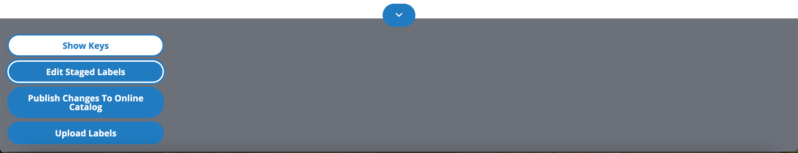
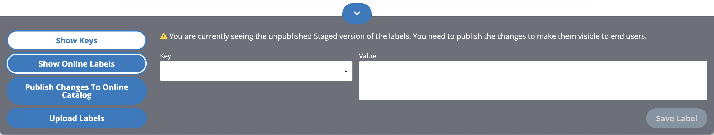
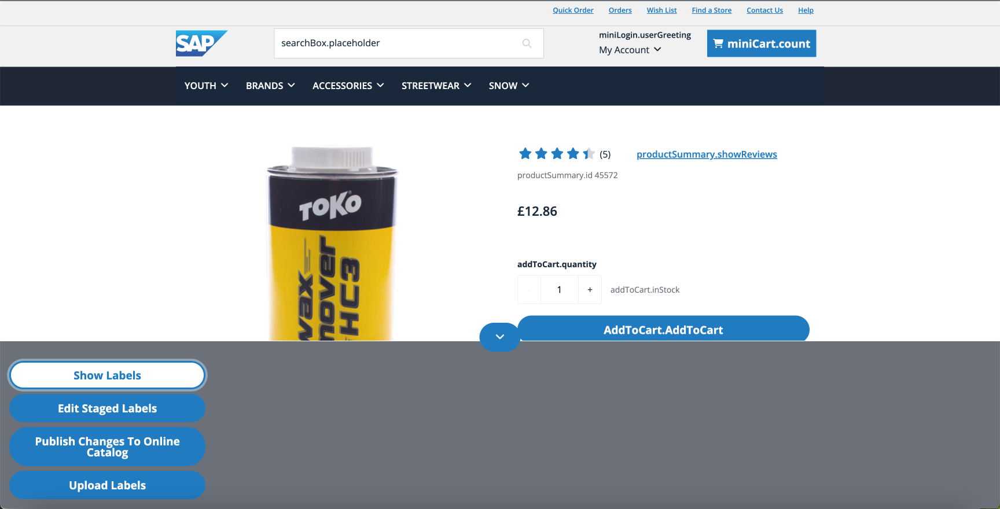
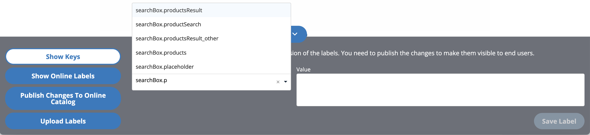
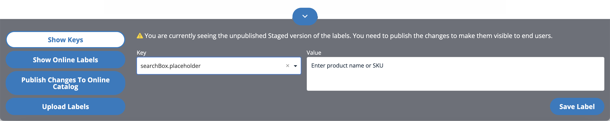

# Managing Localized Labels in Frontend

## Component Visibility

A special component `CxTranslationsAdminComponent` has been created for the purpose of managing translations on the storefront. It is restricted to be visible only for users with the `frontendTranslatorGroup` - ASM managers or specific users for customers.\
To make the component visible to end users you can choose two approaches:
* make it visible for a CUSTOMER logging into the store - to do so assign the customer to a `frontendTranslatorGroup` group.
* make it visible for an ASM employee logging into the store on behalf of the customer - to do so assign the ASM user to a `frontendTranslatorGroup` group.

## Component Configuration

The following configuration changes can be made to adjust the frontend component.
* Change the min number of characters to be entered in the key input that would trigger a search - driven by Composable Storefront environment variable `translationKeySuggestionMinCharacters` with a default value 3.
* Change the max number of key suggestions to be retrieved for a given search term - a backend property `cxtranslations.keysuggestions.limit` with a default setting 30. 

## Component Features

By default, the component is collapsed. After clicking on the arrow button it would show the **Online** preview of the labels.

You can switch to the **Staged** preview where label edits are possible.

1. **Show keys** - toggles the view between key and value, so it is possible to see what key for the label you see on the screen.

    

   * **Edit Staged Labels** / **Show Online labels** - toggles the catalog version used for displaying labels - **Online** or **Staged**. By default, it displays only the **Online** catalog version. Using the **Staged** catalog version allows to see changes before publishing them to **Online** catalog version. Only in the **Staged** catalog version mode is it possible to add / edit the label value and save the changes to **Staged** catalog version.

   * Type in at least x characters (driven by environment variable `translationKeySuggestionMinCharacters`) in the label key input to see existing keys. The max number of the keys to be retrieved is driven by a property `cxtranslations.keysuggestions.limit` 

     

   * Select a suggested key to see the value of the label.
     

3. **Publish Changes to Online catalog** - Synchronise the content catalog and invalidate the labels cache. This would publish all the Content changes (including labels) to **Online** catalog version making it visible for end users.

    > [!INFO] **FULL synchronization**
    > 
    > This steps executes FULL content catalog version synchronisation which means it would publish ALL content changes not only the LABELS ones.

4. **Upload Translations** - sends all file-based translations from SAP Composable Storefront to the backend overwriting existing values for uploaded keys.
   > [!WARNING] **Only currently selected language is uploaded.**
   >
   > Upload mechanism gets only values from currently selected language in the frontend.
   > 
   > To upload values from other languages simply change the languages in application and click upload button again.
   
   > [!WARNING] **Old values would be overwritten.**
   >
   > This steps loads the translations from RESOURCE files into database. This means it would overwrite ALL the labels previously only stored in Database and not present in resource files.
    
   > [!WARNING] **System will pick-up only currently available labels.**
   >
   > If lazy loading mechanism was developed some labels (these that were not loaded yet) won't be uploaded.

5. The arrow button at the top of the component collapses or opens the component.

### Change Label Value

Changing the label is easy using the CX Translations component. It requires putting the key, a new value (in the currently displayed language) and hitting the Save button. The changes are persisted in the **Staged** catalog version.
The changes won't be visible to end user until they are published to **Online** catalog version and the cache is invalidated.