# Localised Values

## Overview

> [!NOTE] **Special Cases Not Supported**
> 
> **Localized Values** support translations when the localized attribute is a String.
> This approach covers the majority of use cases.
> However, there are known special cases that are currently not supported:
> * **Language-Specific Items**: Instead of having a language-specific value, **ProductFeature** is a language-specific item. This means translations require creating a clone of the item and assigning the relevant language, rather than simply adding a new value.
> > Limited support for ProductFeatures was added, they can be AI-translated from Product panel in the Backoffice. To enable add a `CxProductFeatureLocalizedObjectConfig` item in the Backoffice (Localized Object Configuration panel) or by IMPEX. Currently there is no configuration, all or none attributes are translated for selected Products, and they are not visible in "Localized Value" panel.

> * **Complex Attributes**: CX Translation does not support complex attributes, such as images.


## Configuration

### Localised Values and Localized Object Configs

> [!NOTE] This section describes how to configure items/attributes that should be enabled for translations via **Localized Values** functionality.
> 
> **CONSIDERATION**
> 
> In case any of the attributes are actually managed/translated in an external system they should be removed from the automated configuration. The `cxtranslations.autoconfig.excluded.properties` and `cxtranslations.autoconfig.excluded.types` can be used to exclude attributes or types. See the [Autoconfiguration](#Autoconfiguration)


The extension allows translation of all localized attributes for items in the system.
Virtual items **CxLocalizedValue** are created based on **CxLocalizedObjectConfig** representing the values to be translated and shown in a single list view in Backoffice.

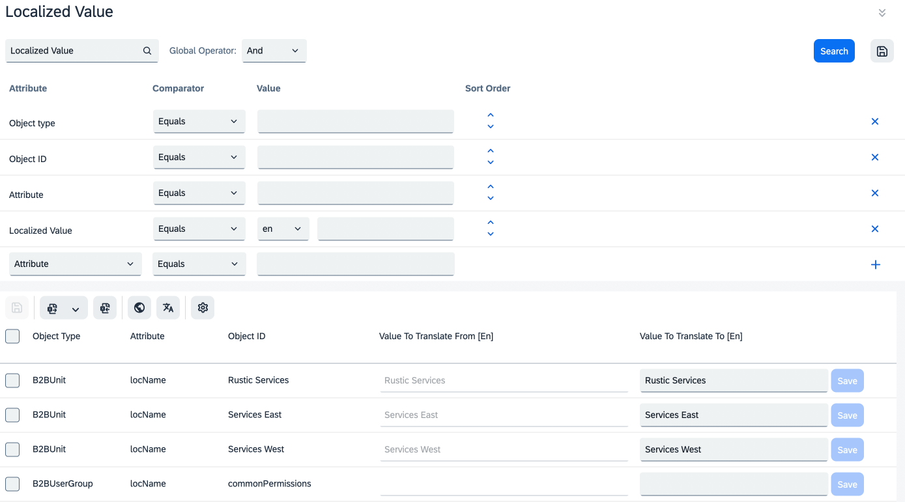

#### **Example 1:**

**CxLocalizedObjectConfig** created for Product and attributes **name**, **summary** and **description**.

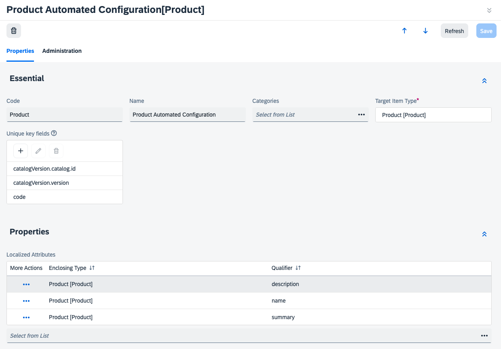

This would result in showing 3 **CxLocalizedValue** for every product:
* **CxLocalizedValue** for **name**
* **CxLocalizedValue** for **description**
* **CxLocalizedValue** for **summary**

#### **Example 2:**

**CxLocalizedObjectConfig** created for **CmsParagraphComponent** and attributes **content**. Assuming you have two content catalogs in the system:
* **Powertools Content Catalog**
* **SPA Powertools Content Catalog**

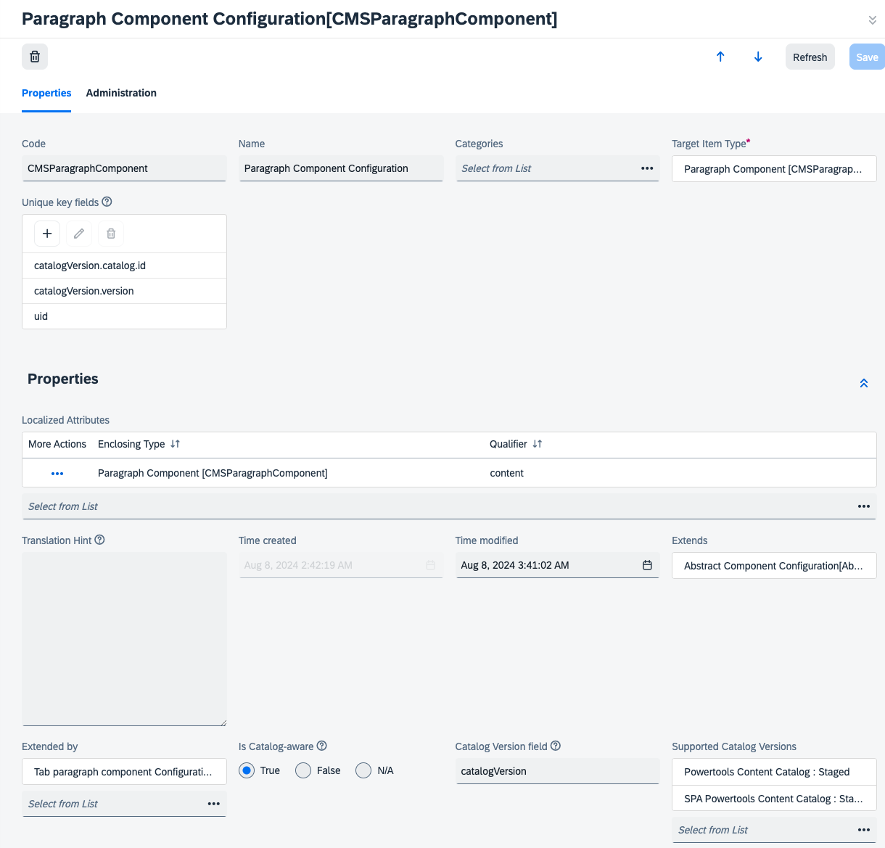

This would result in showing 2 **CmsParagraphComponent** for every paragraph:
* **CmsParagraphComponent** for **content** in catalog **Powertools Content Catalog**
* **CmsParagraphComponent** for **content** in catalog **SPA Powertools Content Catalog**

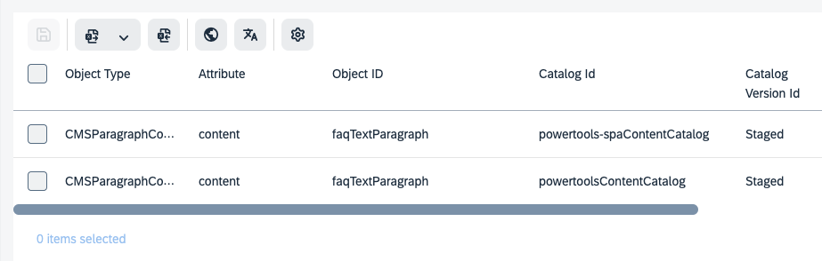

### Autoconfiguration

The configuration for all items that do have localized string attributes can be automatically created during system update.
See below properties that can be adjusted to change or enable the process.
* `cxtranslations.autoconfig.enabled` - defines if the autoconfiguration should be enabled.
* `cxtranslations.autoconfig.checkdata.enabled` - create the configuration only if for at least one item there are non-null attributes values present.
* `cxtranslations.autoconfig.excluded.catalogPatterns` - comma separate list of excluded catalog patters. Defines a pattern used to filter the catalogs for object configuration.
  * Example: Banner component wit uid "Home page banner" exists in several content catalogs. If it is intended to execute the translation only in subset of the catalogs the property should be set to filter out the catalog versions for which the translations should be skipped.
* `cxtranslations.autoconfig.excluded.types` - comma separated list of excluded item types.
  * Example: `Theme,SavedQuery,RendererTemplate` - items which are not intended for frontend translations.
* `cxtranslations.autoconfig.excluded.properties` - comma separated list of excluded properties for which the autoconfiguration should not be executed. In format of `<type>.<property>`.
  * Example: `BaseSite.locale` attribute is not storing a localised label but rather is part of base site configuration for the used locales.
* `cxtranslations.autoconfig.merge.mode` - in case of running the autoconfiguration again. Defines how to treat existing configurations:
  * `KEEP_EXISTING` - avoid updating configuration if already exists, keep existing one
  * `REPLACE` - create the configuration again

#### Autoconfiguration Properties - Default Values
```properties
# Autoconfiguration
cxtranslations.autoconfig.enabled=true
cxtranslations.autoconfig.checkdata.enabled=true
cxtranslations.autoconfig.excluded.catalogPatterns=_boconfig
cxtranslations.autoconfig.excluded.types=Theme,SavedQuery,RendererTemplate,WorkflowTemplate,AbstractWorkflowAction,WorkflowActionTemplate,AutomatedWorkflowActionTemplate,AbstractConstraint
cxtranslations.autoconfig.excluded.properties=BaseSite.locale,
cxtranslations.autoconfig.merge.mode=REPLACE
```

#### Executing Auto Configuration
There are two ways to execute the autoconfiguration:
* Initial execution during system update for all item types. 
* Manual execution by running a configurable **CxLocalizedObjectConfigCronJob**

##### Initial Autoconfiguration
The initial autoconfiguration is enabled by setting the `cxtranslations.autoconfig.enabled` to true. It's enabled by default and would be executed automatically with project data of the `cxtranslations` extension.
It runs for all the item types in the system that:
* Have at least one localized attribute not excluded. The list of excluded attributes per types are defined by property `cxtranslations.autoconfig.excluded.properties`.
* Have a unique attribute/attributes or unique keys are configured:
  * cxtranslations.autoconfig.customUniqueFields property is used to add unique keys for the types that do not have unique attributes configured.
  * Example : `cxtranslations.autoconfig.customUniqueFields=ConsentTemplate->[baseSite.uid,id,version],SolrIndexedProperty->[solrIndexedType.Identifier,name]
* Are not excluded - configurable list of excluded type codes define by property `cxtranslations.autoconfig.excluded.types`.
The configuration is build in a tree structure with inheritance.

##### Manual Autoconfiguration

Manual configuration can be achieved by running a configurable **CxLocalizedObjectConfigCronJob**. 
Navigate to **Background processes** to **Cx Localized Object Config Cron Job**.

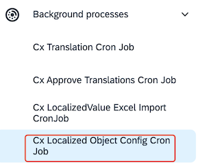

* Create a new cron job and configure it properly:
  * **Types to include** - if nothing is provided, all item types will be taken into account
  * **Types to exclude** - it's predefined list is specified by the `cxtranslations.autoconfig.excluded.types`
  * **Attributes to exclude** - predefined list is specified by the `cxtranslations.autoconfig.excluded.properties`
  * **Localized Object Categories** - an object category to be assigned to all configu`rations
  * **Merge mode** - merge mode:
    * `KEEP_EXISTING` - keeps the already created configurations untouched 
    * `REPLACE` - replaces the already created configurations. 
  * **Add attributes only for existing data** - flag indicating if the configuration should be only imported for attributes that actually contain data
  * **Catalog versions** - list of catalog versions to be taken into account. Predefined with a list of all NOT active catalog versions and classification versions filtered further based on the property `cxtranslations.autoconfig.excluded.catalogPatterns`.

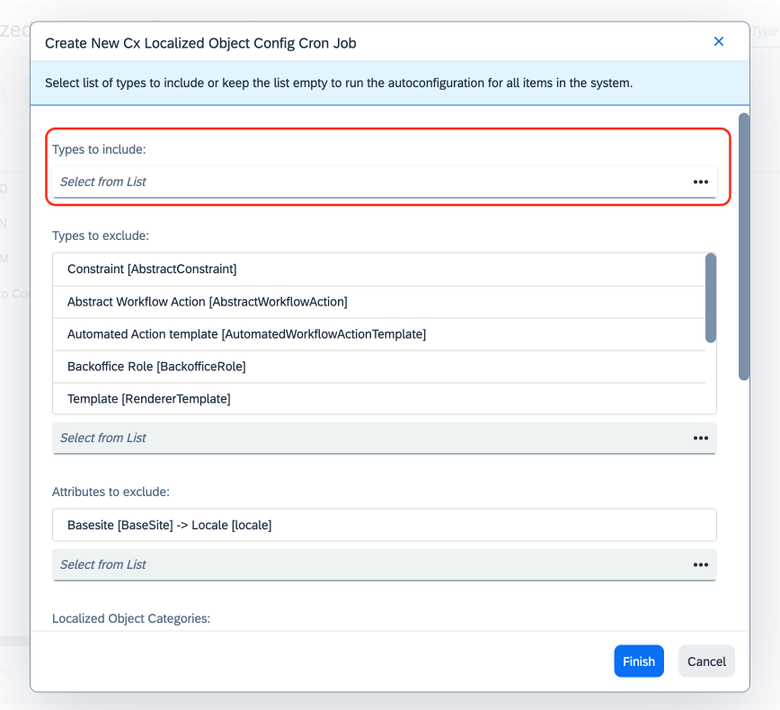   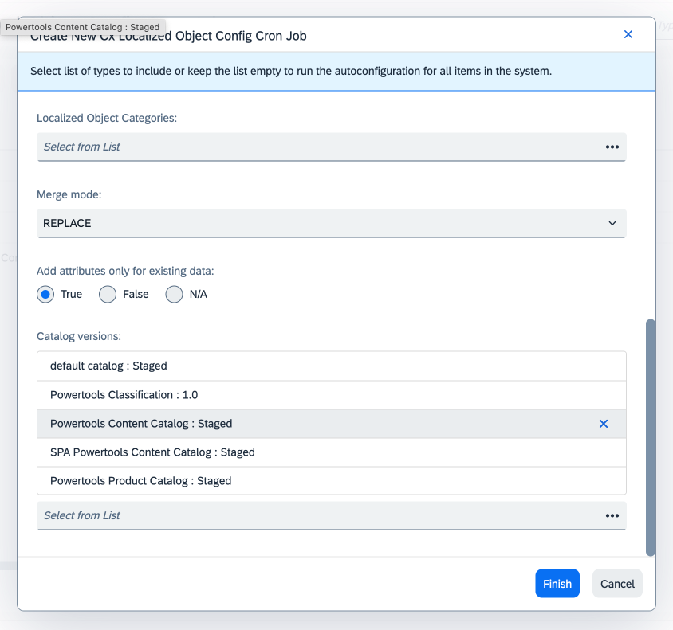

* Execute the newly created **CxLocalizedObjectConfigCronJob**.

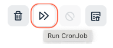

* The progress can be observed in the processes widget in the top right corner

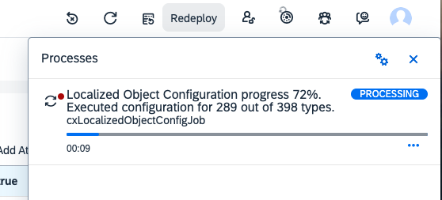

## Providing Translations Manually

The **CxLocalizedValue** provide an easy way to manage translations manually. They represent a virtual view of the localised attribute and can show the attribute in two different languages at the same time. 
As the **CxLocalizedValue** works as a proxy for the target attribute saving it will save the new localised value on the target item.

### Searching for Localized Values
Advanced Search filters can be used to find Localized Values. If the search is done by 'value' itself (for example if searching for ones containing specific text or being empty for specific language), then a limitation
regarding number of results applies for performance reasons. It can be adjusted by the configuration property `cxtranslations.standardProvider.searchByValueLimit`, default value is 1000.

### Primary & Secondary Language Action for Localized Values

Works the same way as Primary & Secondary Language Action for [Localized Labels](/localisedLabels/localizedLabels_backoffice.md#primary-amp-secondary-language-action).


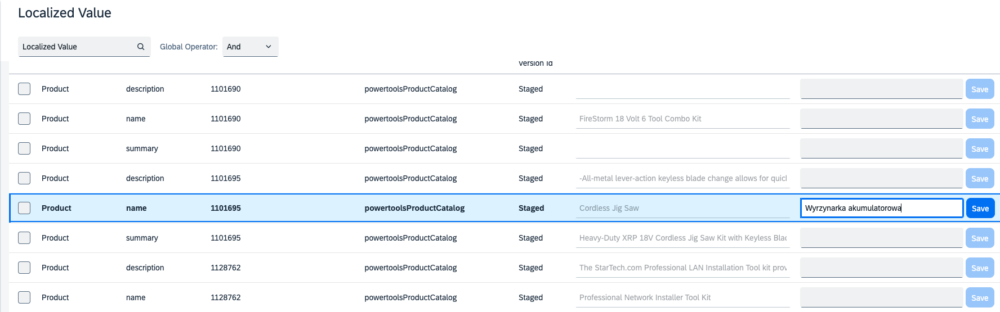

### Saving CxLocalizedValue

Saving the changes, store the translation directly at the target item. This can be done:
* For a single value - by clicking on **SAVE** Button or `enter`
* For all selected and modified items by clicking on **SAVE** action

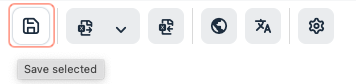
## Working with Excel

### Excel Export

A list of **CxLocalizedValue** can be exported to excel. The Excel export action would open a popup which allows to select the list of values in selected languages.

There is a limit how many items may be exported at once. This limit is managed by property:
```properties
backoffice.excel.export.max.rows=2000
```

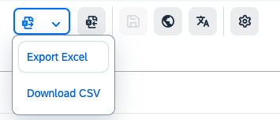

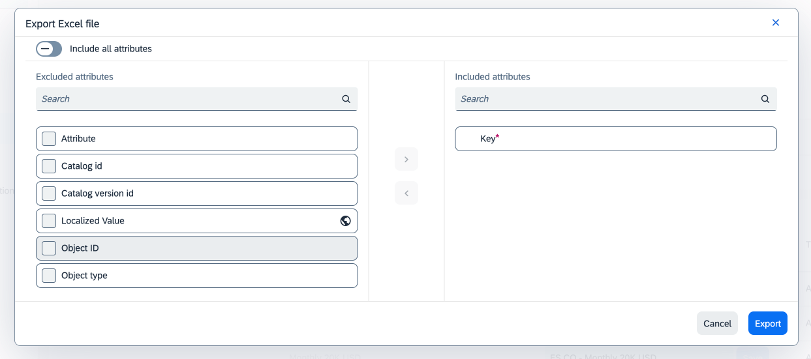

### Excel Import

A properly formatted Excel file prepared by **Excel Export** action (see the section [Excel Export](#excel-export)) containing the **CxLocalizedValue** can be imported using the **Import Excel** action. The Excel file needs to contain:
* the **key** column to uniquely identify the **CxLocalizedValue** for update
* one or more **value** columns to hold the value to be imported

```properties
backoffice.excel.import.max.rows=2000
```

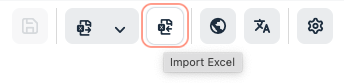

A popup would be shown asking the end user to provide Excel to import. After clicking on **Import** button the import would start in the background as **CxLocalizedValueExcelImportCronJob**. 

> [!INFO]
> 
> In case the Excel contains tabs for other item types then **CxLocalizedValue** they will be ignored.
> Only the **key** and **value** columns would be taken into account. Other columns would be ignored.


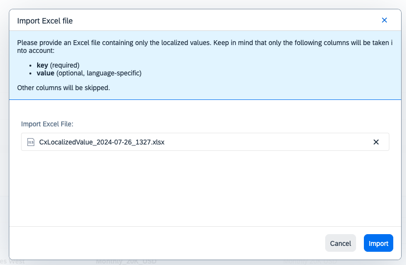


The progress can be monitored by checking the running processes in Backoffice.

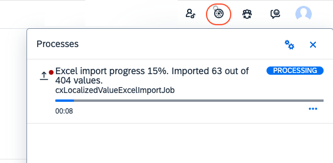

