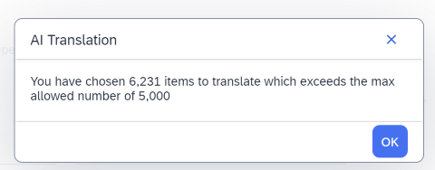
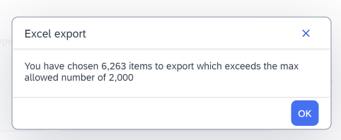

# Troubleshooting
## Backoffice


### Only localized values from one language were imported to backoffice for Localized Labels

**Problem:**

In backoffice I can see that Localized Labels have only one language set.

**Solution:**

Upload mechanism gets only values from currently selected language in the frontend.\
To upload values from other languages simply change the languages in application and click upload button again.

### Limit for objects that can be picked for automatic translation

**Problem:**

When selecting automatic translation option:


Employee may see an error:



> [!WARNING]
> You have chosen XXXX items to translate which exceeds the max allowed number of 5,000.


**Solution:**

To change the limit go to `cxtranslationsbackoffice-backoffice-config.xml` and change `max.rows` related value in this piece of code:

```xml
<context type="CxLocalizedValue" parent="CxAbstractLocalizedValue" merge-by="type">

		<context component="listviewactions" merge-by="type">
			<y:actions>
				<y:group qualifier="translate" show-group-header="false" show-separator="true" position="50">
					<y:action action-id="com.sap.cx.translations.backoffice.widgets.actions.aitranslate"
							  property="pageable.typeCode"
							  position="80">
						<y:parameter>
							<y:name>max.rows</y:name>
							<y:value>5000</y:value>
						</y:parameter>
						<y:parameter>
                            <y:name>safety.threshold</y:name>
                            <y:value>3000</y:value>
                        </y:parameter>
                    </y:action>
                </y:group>
            </y:actions>
        </context>
</context>
```

### Limit for objects that can be exported to Excel

**Problem:**

When selecting export to excel option:


Employee may see an error:



> [!WARNING]
> You have chosen XXXX items to export which exceeds the max allowed number of 2,000.


**Solution:**

This limit can be changed by adjusting `backoffice.excel.export.max.rows` property.\
For details go [here](/localisedLabels/localizedLabels_backoffice.md#bulk-edit)


### Problem with exported Excel

**Problem:**

There are problems with working with Excel that is a result of export from backoffice (can't copy data from Excel to another Excel etc.).

**No solution yet:**

This is unfortunately an issue on core solution, the same issues are related with any Excel created as a result of data export from backoffice.

## Frontend

### I can't see changes in frontend

**Problem:**

I have changed values of Localized Labels in backoffice but I can't see the changes.

**Solution:**

This can be due to cache settings, for details go [here](/localisedLabels/localizedLabels_configuration.md#cache).

* For local installations you can clear cache from hac:\
hac -> Monitoring -> Clear cache\
In CCV2 usually hac is not available in nodes where this data is cached (API nodes)

* In frontend, using option to **Publish changes to Online Catalog** not only synchronizes data from Staged to Online catalog but also calls a service that will broadcast request to clear labels related cache in all nodes.\
For details go [here](/localisedLabels/localizedLabels_storefront.md#component-features)


